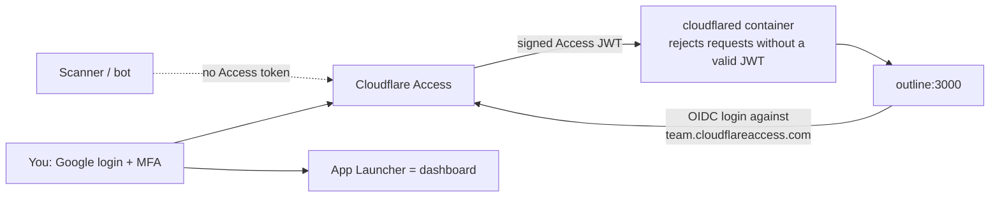

# Cloudflare + cPanel runbook (the public door)

Humans reach Outline from anywhere through Cloudflare Access with Google. The
domain's website and email stay on cPanel. Your own machines use the
[private path](private-path.md) instead; machines that cannot join the tailnet
use Cloudflare service tokens (Part D).

## How the public door works



- **No inbound ports.** The server makes an outbound connection to Cloudflare.
- **Deny by default at the edge.** Access forwards only identities you allowed.
  Everyone else, including bots, sees Cloudflare's login page.
- **Deny again at the connector.** `cloudflared` verifies the Access JWT for
  each hostname (`access.required: true`, the app's AUD tags). A dashboard
  mistake cannot expose the origin. Unknown hostnames get `404`.
- **One login.** Outline's sign-in is an OpenID Connect login against an
  "Access for SaaS" application, so the Google session that opened the gate
  also signs you into Outline. Outline needs `sub`, `email` and a name; Access
  passes exactly those. The first login creates the workspace
  (`outline_app_name`), keyed on your email domain.
- **Dashboard.** `https://<team>.cloudflareaccess.com` lists every application
  you may open. New services appear automatically.

## Part A: move DNS to Cloudflare, keep cPanel site and mail

1. In cPanel **Zone Editor**, export or screenshot every record (A, AAAA,
   CNAME, MX, TXT for SPF/DKIM/DMARC, SRV, verification records).
2. In Cloudflare, **Add a domain** and let it scan. Compare with the export.
   Mail hosts and third-party verification CNAMEs must be **DNS only**; the
   main website (`@`, `www`) can be **Proxied**.
3. If DNSSEC is on at the registrar, disable it before changing nameservers.
4. At the registrar, replace the nameservers with the two Cloudflare assigned.
   Wait for **Active**.
5. Re-enable DNSSEC in Cloudflare and publish the DS record at the registrar.
6. Zone settings: **SSL/TLS** Full (strict), **Always Use HTTPS**, minimum
   TLS 1.2. **Security > Bots: leave Bot Fight Mode OFF.** It cannot be
   bypassed by any rule and challenges API, OAuth and mobile traffic, which
   breaks the Android app, MCP clients and agents. Test the website and send a
   test email before continuing.

cPanel's zone editor no longer controls the public zone. Protect cPanel itself:
2FA on, management ports restricted by the host if possible.

## Part B: Zero Trust (one-time)

1. **Team domain.** Zero Trust > Settings > Custom Pages shows
   `<team>.cloudflareaccess.com`. `<team>` is `cloudflare_access_team_name`.
2. **Login method.** Settings > Authentication > Login methods > **Google**
   (OAuth client in Google Cloud Console with the redirect URL Cloudflare
   shows). Turn on 2-Step Verification on the Google account. Keep **One-time
   PIN** out of your policies.
3. **Self-hosted application** (the gate): Access controls > Applications >
   Create > Self-hosted. Domain `notes.example.com`, session about 8h. Policy
   **Allow**: *Emails* = yours; *Require* *Login methods* = Google. **Show in
   App Launcher** on. Copy **Overview > Application Audience (AUD) Tag** into
   `cloudflare_access_outline_aud`.
4. **SaaS application** (Outline's identity provider): Create > **SaaS** >
   OIDC. Redirect URL `https://notes.example.com/auth/oidc.callback`. Scopes
   `openid email profile`. Same Allow policy. Copy **Client ID** into
   `cloudflare_access_oidc_client_id` and **Client secret** into
   `cloudflare_access_oidc_client_secret` (secrets.yml). App Launcher off.
5. **Tunnel** (from your Mac):

   ```bash
   brew install cloudflared
   cloudflared tunnel login
   cloudflared tunnel create selfhosted          # writes ~/.cloudflared/<UUID>.json
   cloudflared tunnel route dns selfhosted notes.example.com
   ```

   Paste the JSON into `cloudflare_tunnel_credentials` in `secrets.yml`.
6. **DNS API token** (for the private path's certificates): Profile > API
   Tokens > *Edit zone DNS* template, scoped to this one zone, into
   `cloudflare_dns_api_token`.
7. **Rate limit** (free plan allows one rule): Security > WAF > Rate limiting
   rules: path starts with `/api/` or `/oauth/`, 100 requests per 10 seconds
   per IP, block for 10 seconds. Caching > Cache Rules: bypass cache for the
   hostname.

## Part C: deploy

1. Fill `production.yml` from `examples/production.yml` and `secrets.yml`
   from `examples/secrets.yml`; `ansible-vault encrypt secrets.yml`.
2. Run:

   ```bash
   .venv/bin/python tests/validate_security.py
   ansible-playbook site.yml -e @production.yml -e @secrets.yml --ask-vault-pass --check --diff
   ansible-playbook site.yml -e @production.yml -e @secrets.yml --ask-vault-pass
   ```

3. `docker compose -f /opt/selfhosted/edge/docker-compose.yml logs -f`:
   cloudflared logs `Registered tunnel connection` four times.
4. Open `https://notes.example.com`: Google, then Outline creates your
   workspace. Settings > Workspace > **AI**: enable MCP (also enables the
   OAuth registration the Android app needs).

## Part D: machines that cannot join the tailnet (service tokens)

Most machines should use the [private path](private-path.md). For hosted CI
or an agent on a platform without Tailscale:

1. Access controls > Service credentials > **Service Tokens** > create one per
   client, 1-year expiry. Note the Client ID and Secret.
2. Create a second self-hosted application for the path
   `notes.example.com/api/*` (and one for `/mcp` if needed). Policies: the
   same **Allow** for your emails (the Outline web app also calls `/api/*`)
   **plus** a **Service Auth** policy including that service token. Enable
   strict service-token mode. Copy the AUD tag(s) into
   `cloudflare_access_api_aud` / `cloudflare_access_mcp_aud` and redeploy:
   cloudflared accepts tokens for those apps.
3. Client sends `CF-Access-Client-Id`, `CF-Access-Client-Secret` and
   `Authorization: Bearer <Outline API key>`. Without the token the answer is
   401; see `examples/clients/`.

## Acceptance checks

1. Incognito to `https://notes.example.com`: Access login; a non-allowed
   Google account is denied.
2. `curl -sI https://notes.example.com` from anywhere: `302` to
   `<team>.cloudflareaccess.com`.
3. `nmap -Pn -p 22,53,80,443,3000,5432,6379,9000 <public-ip>` from outside:
   nothing, or SSH only.
4. Website, mail, SPF/DKIM/DMARC and cPanel AutoSSL still work.
5. Service token (if used): with headers 200, without 401; browser still works.
6. Zero Trust > Logs > Access shows your logins and nothing unexpected.

## Ongoing

- Keep MFA on the registrar, Cloudflare, cPanel and Google accounts. Add a
  second Cloudflare admin or keep recovery codes offline: losing the Google
  account means losing the login.
- Rotate service tokens before expiry; review Access logs monthly.
