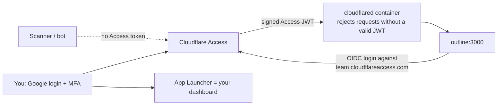

# Cloudflare + cPanel runbook

Exposes Outline on your own domain, signed in with Google (or any identity
provider Cloudflare supports), while the domain's website and email stay on
cPanel. The playbook deploys everything on the server; the Cloudflare objects
(tunnel, Access applications, DNS names) are created once with the steps below.

## How it works (auth_mode: cloudflare, recommended)



- **No inbound ports.** The server makes an outbound connection to Cloudflare.
  Nothing on the host listens publicly. Port scans find nothing.
- **Deny by default at the edge.** Cloudflare Access only forwards requests
  from identities you allowed. Everyone else, including bots, sees the login
  page at Cloudflare and never reaches your server.
- **Deny again at the connector.** `cloudflared` verifies the Access JWT for
  the hostname (`access.required: true` with the app's AUD tag). A mistake in
  the dashboard cannot expose the origin. Unknown hostnames get `404`.
- **One login.** Outline's own sign-in is an OpenID Connect login against an
  "Access for SaaS" application, so the same Google session that opened the
  Access gate signs you into Outline. Nothing else to run or remember.
- **Dashboard.** `https://<team>.cloudflareaccess.com` is the App Launcher:
  one tile per application you are allowed to open. Each new service you add
  behind Access shows up there automatically.

Outline needs `sub`, `email` and a name from the identity provider; Access
passes exactly those from Google. Your first login creates the workspace,
named by `outline_app_name`, keyed on your email domain.

## Part A: move DNS to Cloudflare, keep cPanel site and mail

1. In cPanel, open **Zone Editor** and export or screenshot every record for
   the domain (A, AAAA, CNAME, MX, TXT for SPF/DKIM/DMARC, SRV, verification
   records).
2. In Cloudflare, **Add a domain** and let it scan. Compare against your
   export and add anything missing. Mail hosts (`mail`, MX targets) and any
   third-party verification CNAMEs must be **DNS only** (grey cloud). The main
   website (`@`, `www`) can be **Proxied**.
3. If DNSSEC is enabled at the registrar, disable it before changing
   nameservers. Changing nameservers with stale DS records breaks resolution.
4. At the registrar (often the same cPanel host), replace the nameservers with
   the two Cloudflare assigned. Wait until the zone shows **Active**.
5. Re-enable DNSSEC in Cloudflare and publish the DS record at the registrar.
6. Zone hardening: **SSL/TLS** mode Full (strict), **Always Use HTTPS** on,
   minimum TLS 1.2. cPanel AutoSSL keeps renewing through the proxy over
   HTTP-01; alternatively install a Cloudflare Origin CA certificate in cPanel.
   Test the main site and send/receive a test email before continuing.

cPanel's zone editor no longer controls the public zone after this. Protect
cPanel itself separately: enable cPanel 2FA and ask the host to restrict
`:2083`/`:2087` if you can.

## Part B: Zero Trust (one-time)

1. **Team domain.** Zero Trust > Settings > Custom Pages shows
   `<team>.cloudflareaccess.com`. `<team>` is `cloudflare_access_team_name`.
2. **Identity provider.** Zero Trust > Settings > Authentication > Login methods
   > **Google** (create an OAuth client in Google Cloud Console with the
   redirect URL Cloudflare shows). Turn on 2-Step Verification on the Google
   account. Microsoft, GitHub, Apple etc. work the same way. Keep **One-time
   PIN** out of your policies; it is weaker than a real MFA login.
3. **Self-hosted application** for Outline: Zero Trust > Access controls >
   Applications > Create > Self-hosted.
   - Domain `notes.example.com`, session duration about 8h.
   - Policy **Allow**: *Emails* = your exact address(es). Add a *Require*
     rule *Login methods* = Google so nothing weaker is accepted.
   - Experience settings: **Show in App Launcher** on (this is the tile on
     your dashboard).
   - After creating, open **Overview** and copy the **Application Audience
     (AUD) Tag** into `cloudflare_access_outline_aud`.
4. **SaaS application** (Outline's identity provider): Applications > Create >
   **SaaS** > OIDC.
   - Redirect URL `https://notes.example.com/auth/oidc.callback`.
   - Scopes: `openid`, `email`, `profile`. Default authorization-code flow.
   - Same Allow policy and Google login method as step 3.
   - Copy **Client ID** into `cloudflare_access_oidc_client_id` and **Client
     secret** into `cloudflare_access_oidc_client_secret` (secrets.yml).
   - Turn **Show in App Launcher** off for this one; it is not a page.
5. **Tunnel** (locally managed, from your Mac):

   ```bash
   brew install cloudflared
   cloudflared tunnel login                 # browser: choose the zone
   cloudflared tunnel create selfhosted     # prints ~/.cloudflared/<UUID>.json
   cloudflared tunnel route dns selfhosted notes.example.com
   ```

   Paste the JSON file's content into `cloudflare_tunnel_credentials` in
   `secrets.yml`. The route command creates a proxied CNAME to
   `<UUID>.cfargotunnel.com`; the hostname resolves only to Cloudflare.
6. **Zone extras.** Security > Bots: enable **Bot Fight Mode**. Caching >
   Cache Rules: *Bypass cache* for the hostname. Security > WAF: turn on the
   managed rules available on your plan. These are belt-and-braces; Access is
   what actually keeps traffic out.

## Part C: deploy

1. Fill `production.yml` from `examples/production.yml`: `auth_mode:
   cloudflare`, `cloudflare_tunnel_enabled: true`, the HTTPS Outline URL,
   team name, AUD tag, OIDC client ID, image digests for Outline, PostgreSQL,
   Redis and cloudflared, SMTP, and `firewall_*` once you know how you reach
   SSH (Tailscale range `100.64.0.0/10` if that is your path).
2. Fill and vault-encrypt `secrets.yml`.
3. Run:

   ```bash
   .venv/bin/python tests/validate_security.py
   ansible-playbook site.yml -e @production.yml -e @secrets.yml --ask-vault-pass
   ```

   The playbook creates the `selfhosted_edge` network, renders
   `/opt/selfhosted/edge/` (`cloudflared/config.yml` and credentials with mode
   `0400` for uid 65532), runs `cloudflared ... ingress validate`, enables UFW
   (deny inbound except SSH) and starts the Outline and edge stacks.
4. Watch `docker compose -f /opt/selfhosted/edge/docker-compose.yml logs -f`.
   cloudflared must log `Registered tunnel connection` four times.
5. Open `https://notes.example.com`. Access asks for Google, then Outline
   redirects to Access again (already signed in) and creates your workspace.
6. Test logout, uploads and live editing in two tabs. Then open
   `https://<team>.cloudflareaccess.com`: that is your dashboard.

## Alternative: self-hosted Authentik (auth_mode: authentik)

Use this only if you need a full identity provider of your own (local users,
LDAP, many apps with different rules). It costs a second login, two more
containers, a second PostgreSQL, about 1.5 GB more RAM, and a private TLS
route: Outline fetches Authentik's discovery document server-side, so the
playbook runs a Caddy container with a Let's Encrypt certificate (DNS-01 via a
zone-scoped Cloudflare token) that the Outline container reaches through a
Docker network alias, never through the Access gate.

Extra one-time steps: a second self-hosted Access application for
`auth.example.com` (its AUD into `cloudflare_access_authentik_aud`), a DNS
route for it, the DNS API token (*Edit zone DNS* template, one zone) into
`cloudflare_dns_api_token`, `acme_email`, and digests for Caddy and its
builder image. Do **not** use this Authentik as the Access identity
provider: it would have to authenticate through itself. After deployment,
finish Authentik at `/if/flow/initial-setup/`, enrol admin MFA, create the
OAuth2 provider (redirect URI `https://notes.example.com/auth/oidc.callback`)
and the application with slug `outline`.

## Acceptance checks

1. Incognito browser to the hostname: Cloudflare Access login appears. A
   non-allowed Google account is denied. After the session duration, you
   re-login.
2. `curl -sI https://notes.example.com` from any network returns a `302` to
   `<team>.cloudflareaccess.com`; nothing from Outline is visible.
3. From outside the server: `nmap -Pn -p 22,80,443,3000,5432,6379,8025,9000 <server-ip>`
   (IPv4 and IPv6) shows only SSH, or nothing if SSH is Tailscale-only.
4. On the server: `ss -ltnp` lists no Docker-published app ports.
5. Main website, email delivery, SPF/DKIM/DMARC, and cPanel AutoSSL renewal
   still work after the nameserver change.
6. Backups of the PostgreSQL volume, Outline uploads, `/opt/selfhosted` and
   the vaulted secrets restore successfully.

## Ongoing

- Enable unattended security upgrades on the host; rotate image digests on a
  schedule after testing.
- Keep MFA/passkeys on the registrar, Cloudflare, cPanel and Google accounts.
  Losing the Google account means losing the login; keep Cloudflare's
  emergency access (a second admin or recovery codes) somewhere safe.
- Review Zero Trust > Logs > Access periodically for denied attempts.
